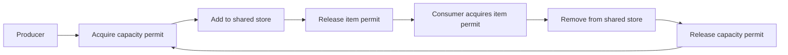

# Java Concurrency Lab

**Threads, shared-state protection, asynchronous results, and producer–consumer coordination.**

What happens when two tasks update the same value? How can workers share limited capacity? When does creating more tasks become a resource problem? This repository explores those backend engineering questions through small Java examples using `Runnable`, `Callable`, executor services, futures, locks, synchronization, and semaphores.

Built as part of my transition from a business education and e-commerce operations into software engineering, this project connects familiar operational concerns—work arriving, workers processing it, and shared resources—with the Java mechanisms used to coordinate concurrent execution.

**Status:** a collection of source-level learning experiments. The current `master` branch has compilation and runtime issues documented below; successful execution, performance improvements, and production readiness are not claimed.

[Explore the source](https://github.com/FaiazS/Threads_In_Java/tree/master/src/main/java/com/scaler) · [Build configuration](https://github.com/FaiazS/Threads_In_Java/blob/master/pom.xml)

## Why these concepts matter

Backend applications often handle overlapping work: requests updating shared state, background tasks waiting for results, or producers submitting work faster than consumers can process it. Understanding coordination is a foundation for reasoning about correctness, resource usage, and predictable behavior.

| Concern | Example in this repository | Practical relevance |
|---|---|---|
| Scheduling work | Individual threads and executor pools | Choosing how tasks are launched and how execution resources are managed |
| Retrieving a task result | Recursive Fibonacci with `Callable<Integer>` and `Future<Integer>` | Understanding asynchronous work, waiting, and failure propagation |
| Protecting shared updates | Adder/subtractor examples | Reasoning about counters and other mutable state accessed by multiple workers |
| Limiting work in a shared store | Producer–consumer semaphores | Exploring capacity limits and coordination between stages of a pipeline |
| Releasing resources | Executor and lock lifecycle gaps | Recognizing why cleanup and cancellation belong in a complete design |

These are connections to real application concerns, not claims that the repository implements an inventory service, production queue, or deployed backend.

## A guided tour of the implementation

### 1. Task execution, pools, and futures

[JavaMultiThreadingAndConcurrency1](https://github.com/FaiazS/Threads_In_Java/tree/master/src/main/java/com/scaler/JavaMultiThreadingAndConcurrency1)

- `PrintSum`, `NSum`, and `NumberPrinter` define `Runnable` work.
- `Client` starts individual `Thread` instances and submits number-printing work to a fixed pool of five workers.
- The same client uses a cached executor for `NthFibonacciNumber`, a recursive `Callable<Integer>` that submits two child tasks and combines their `Future.get()` results.
- `AdderSubtractorClient` shares a value between two `Callable<Void>` tasks, supplies a `ReentrantLock`, and waits for both futures before reading the result.

The examples make several distinctions visible: a task describes the work; a thread or executor runs it; a future represents pending completion or a result. Waiting for completion and protecting a shared update are separate responsibilities.

### 2. Synchronized blocks

[JavaMultiThreadingAndConcurrency2](https://github.com/FaiazS/Threads_In_Java/tree/master/src/main/java/com/scaler/JavaMultiThreadingAndConcurrency2)

The adder/subtractor source explores wrapping a read–modify–write operation in `synchronized (value)`. The intended critical section includes both reading the current value and writing the updated value, rather than treating them as unrelated operations.

The current adder has a type/import and constructor-initialization defect, so this package needs correction before it can demonstrate the intended shared-object synchronization reliably.

### 3. Synchronized methods

[JavaMultiThreadingAndConcurrency3](https://github.com/FaiazS/Threads_In_Java/tree/master/src/main/java/com/scaler/JavaMultiThreadingAndConcurrency3)

This package explores moving synchronization into the value object's update methods. Its local `Value` class declares synchronized addition and subtraction, while the worker source currently refers to the first package's `Value`, which also has synchronized update methods.

The client has inconsistent imports, a constructor mismatch, and an undeclared `lock` reference. The source illustrates the intended design direction, but the package is not currently a working comparison with the earlier examples.

### 4. Producer–consumer coordination

[ProducerConsumerV1](https://github.com/FaiazS/Threads_In_Java/tree/master/src/main/java/com/scaler/ProducerConsumer/ProducerConsumerV1)

The client creates a shared `Store`, starts ten producer tasks and ten consumer tasks, and supplies two semaphores:

- Producer permits start at **10**, representing available capacity.
- Consumer permits start at **0**, representing available items.

The source follows this handoff pattern:



`Store` uses a `ConcurrentLinkedDeque<Object>` and synchronized mutation methods. The intended capacity limit is tracked through semaphore permits; the deque itself is not a bounded buffer.

The current producer inserts the deque object itself, and the consumer removes that same object. A meaningful next version needs actual work items, an encapsulated handoff operation, and a defined shutdown policy.

## Source map

The source contains **22 Java files** across the example groups and the top-level entry point.

```text
src/main/java/com/scaler/
├── Main.java
├── JavaMultiThreadingAndConcurrency1/
│   ├── Client.java
│   ├── PrintSum.java
│   ├── NSum.java
│   ├── NumberPrinter.java
│   ├── NthFibonacciNumber.java
│   ├── AdderSubtractorClient.java
│   ├── Adder.java
│   ├── Subtractor.java
│   └── Value.java
├── JavaMultiThreadingAndConcurrency2/
│   ├── Client.java
│   ├── Adder.java
│   ├── Subtractor.java
│   └── Value.java
├── JavaMultiThreadingAndConcurrency3/
│   ├── Client.java
│   ├── Adder.java
│   ├── Subtractor.java
│   └── Value.java
└── ProducerConsumer/ProducerConsumerV1/
    ├── Client.java
    ├── Producer.java
    ├── Consumer.java
    └── Store.java
```

The top-level `com.scaler.Main` prints `Hello, World!`. The concurrency examples have separate client entry points; they are not launched by that main method.

## Current implementation gaps

| Area | Finding in the reviewed source | Consequence |
|---|---|---|
| Explicit lock example | The first package's `Subtractor` assigns `this.lock = this.lock` instead of storing its constructor argument | The field remains null and `lock.lock()` fails when that task runs |
| Synchronized block example | The second package's `Adder` imports the first package's `Value`; the constructor accepting the local `Value` has an empty body | The client selects that constructor, leaving the worker's value field null |
| Synchronized method client | The third client imports workers from the first package, invokes an incompatible adder constructor, and references an undeclared `lock` | The full source tree has compilation blockers |
| Lock cleanup | Explicit `unlock()` calls are not protected by `finally` | An exception inside a critical section could leave the lock held |
| Executor lifecycle | Clients create executor services without closing or shutting them down | Worker resources do not have an explicit release policy |
| Recursive Fibonacci | Each non-base call submits two tasks to the same cached pool and blocks for results | Rapid task growth and resource pressure; this is not evidence of an efficient Fibonacci algorithm |
| Producer–consumer payload | Workers add/remove the store's own deque instead of distinct work items | The demo does not yet represent a useful job or item pipeline |
| Cancellation and invariants | Producer/consumer loops are indefinite, interruption becomes a runtime exception, and callers can obtain the mutable deque | Shutdown behavior and capacity/item consistency need stronger design |

For executor lifecycle, explicit-lock cleanup, and semaphore behavior, see the Java API documentation: [ExecutorService](https://docs.oracle.com/en/java/javase/23/docs/api/java.base/java/util/concurrent/ExecutorService.html), [Lock](https://docs.oracle.com/en/java/javase/23/docs/api/java.base/java/util/concurrent/locks/Lock.html), and [Semaphore](https://docs.oracle.com/en/java/javase/23/docs/api/java.base/java/util/concurrent/Semaphore.html).

## Technology and execution status

- Java **23** source and target level, configured in `pom.xml`
- Maven project: `com.scaler:ThreadDemo:1.0-SNAPSHOT`
- Java standard library and `java.util.concurrent`
- No external application or test dependencies declared in the reviewed POM

The current branch needs the compilation repairs above before a normal full-project build can succeed. This documentation is based on source inspection; no application execution, automated test results, throughput figures, or latency benchmarks are claimed.

## Next engineering milestones

1. Correct package imports, constructor calls, and field initialization so each example has a consistent shared-value type.
2. Guarantee explicit-lock release with `try`/`finally` and give every executor an explicit lifecycle.
3. Isolate each synchronization example so it can be run and compared independently.
4. Add repeatable checks that completed equal additions/subtractions preserve the initial value.
5. Introduce distinct producer–consumer work items and check that none are lost or processed twice.
6. Check capacity limits, cancellation, interruption, and termination under concurrent execution.
7. Rework recursive task granularity before comparing it against a sequential Fibonacci baseline.

These milestones would turn the current experiments into a stronger demonstration of concurrency correctness. Performance improvements should be measured under a documented workload rather than inferred from the presence of multiple threads.

## About the developer

I am developing Java backend skills through projects that connect business workflows to software behavior. This repository reflects my work on a demanding foundation: understanding how tasks execute, how shared state changes, and where coordination can fail. My next step is to make those assumptions explicit, test them, and improve the implementation.

[Explore my GitHub projects](https://github.com/FaiazS) · [Connect on LinkedIn](https://www.linkedin.com/in/faiazahmed22/)
